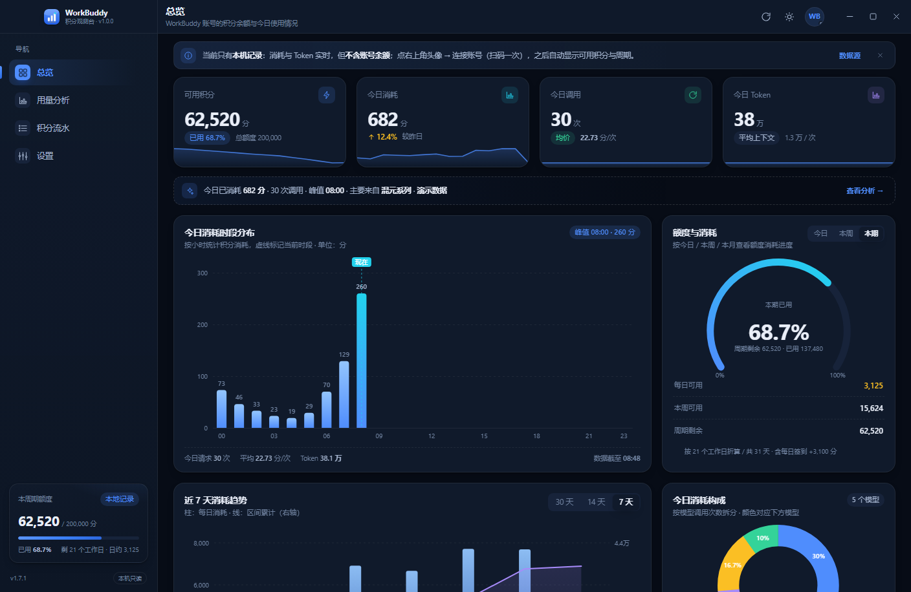
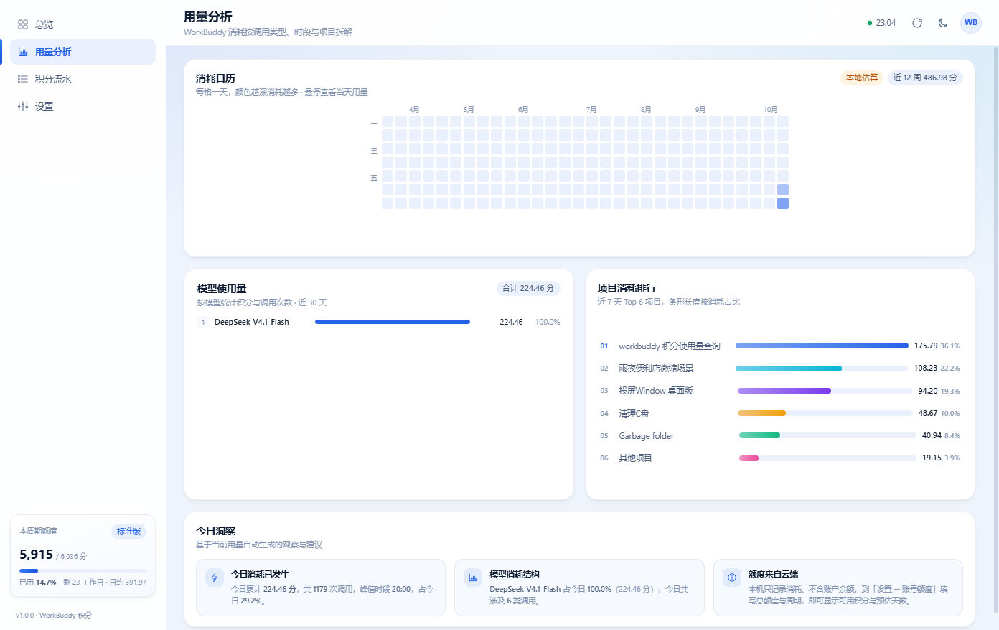
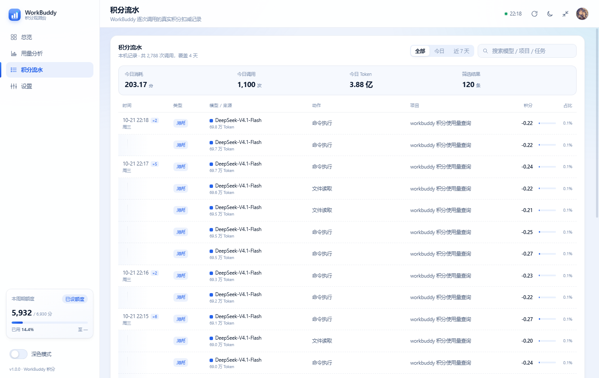
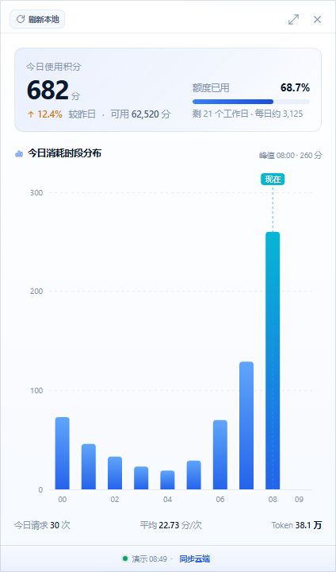

<div align="center">


<h1>WorkBuddy 积分观测台</h1>

<p>把 WorkBuddy 的积分余额、消耗与逐笔流水，做成一扇常驻托盘的桌面看板。</p>

<p>
  
  
  
  
</p>

</div>

[截图](#界面) · [下载安装](#下载安装) · [数据口径](#数据从哪来) · [从源码运行](#从源码运行) · [更新日志](CHANGELOG.md)



## 这是什么

一个只在本机运行的 Windows 桌面小工具。它读两类数据：

- **本机会话记录**：`~/.workbuddy/projects/**/*.jsonl`，逐笔、实时、含项目与 Token；
- **账号云端接口**：余额、周期、账号级逐笔（只读）。

两者合起来，你能在托盘小窗里瞄一眼今天用了多少积分，也能在完整面板里查这一个月花在了哪个模型、哪个项目、哪个小时。

顺带把每天都要手动点一遍的事办了：**启动时自动签到**，并**先领后派猫猫旅行**，结论直接摆在总览顶部。

不需要 Python 环境，安装包 13 MB 左右；不需要服务端，不上传任何数据。

## 功能

- **托盘常驻 + 右下角小窗**：单击托盘弹出小窗，再点收回；小窗显示今日积分、额度与分时柱图。
- **完整面板四页**：总览 / 用量分析 / 积分流水 / 设置，主窗 1408×916，可缩放。
- **总览**：可用积分、今日消耗、调用笔数、Token 四张 KPI，今日时段分布、额度仪表、30 天趋势、消耗构成。
- **用量分析**：整月消耗日历热力图、模型用量排行、项目消耗排行、今日洞察。
- **积分流水**：云端逐笔与本机记录合并，按分钟聚合，支持类型与关键词筛选。
- **启动自动签到**：每次打开程序领当日积分（100 分/天），已签到自动跳过；顺带把猫猫派出去旅行（1–4 小时带回 5–10 分）。签到结论按「成功 / 已签过 / 失败」三态显示在总览顶部，点「我知道了」当天不再打扰。
- **常驻看猫**：程序开着就一直盯着，猫到家立刻领积分；跨天自动签新的一天并重新派出。猫猫每天只能派 1 次，派出后当天不再重复请求。
- **左下角卡片轮播**：额度 / 签到 / 猫猫 / 任务四张同尺寸卡，左右滑或自动翻；小窗里同样四张，点开固定停在「今日使用积分」。
- **再次双击图标**：直接把已运行的主界面叫到前面，不再弹「程序已在运行」。
- **双主题**：深色 / 浅色，图表颜色跟随主题重绘。
- **零图表库**：柱状、环图、仪表、日历、迷你趋势全部手写 SVG，没有 ECharts / D3。

## 界面

<p align="center">
  
  
</p>

<p align="center">
  
  <br>
  <sub>小窗：今日使用积分 / 额度 / 分时分布</sub>
</p>

## 下载安装

有两种下载方式，**推荐绿色版**：

**A. 绿色版 ZIP（推荐，不会被浏览器拦）**

1. 打开 [Releases](../../releases/latest)，下载 `WorkBuddyPoints-<版本>-portable.zip`。
2. 解压到任意目录，双击里面的 `WorkBuddyPoints.exe` 即可，**不需要安装**。
3. 首次启动后，点托盘图标 → 右上角头像 → **连接账号**，扫码登录一次即可同步云端数据。

**B. 安装包 EXE**

1. 下载 `WorkBuddyPoints-Setup-<版本>.exe`，双击安装（会创建开始菜单项，可选"仅为我安装"）。
2. 安装包已内置 Python 运行时，**目标机不需要装 Python**。

> ⚠️ **关于「检测到病毒」的拦截**
>
> 本项目**没有购买代码签名证书**，而 PyInstaller 打包出来的可执行文件在微软看来是
> "来源不明的新文件 + 零下载信誉"，Defender 常会给出
> `Program:Win32/Contebrew.A!ml` 这类**机器学习误报**（`!ml` = ML 推断，不是特征码命中）。
>
> 实测：同一个程序，`WorkBuddyPoints.exe` 扫描结果是干净的，只有安装器会被标记。
>
> 处理办法：
> - 用 Edge 下载被拦时，在下载面板点「···」→「保留」
> - 运行被拦时，点「更多信息」→「仍要运行」
> - **最省事的是直接用上面的绿色版 ZIP**，不经过安装器触发的那条判定
> - 想核对文件完整性，见 Release 页面附带的 SHA256

**如果公司电脑装了企业级 EDR**，可能会拦得更死。这种情况下把源码放本地跑（见「从源码运行」）比硬刚杀软省事。

**系统要求**：Windows 10 1803+ 或 Windows 11，x64。唯一外部依赖是系统自带的 **Microsoft Edge WebView2 运行时**（Win11 自带，Win10 多数已随 Edge 安装；安装向导会检测并提示下载）。

**升级与卸载**：程序目录和用户数据是分开的。登录态、账号缓存、额度配置、日志都在 `%APPDATA%\WorkBuddyPoints`，升级、重装、卸载都不会删除，重装后不用重新扫码。

> 公司电脑没有管理员权限时，在安装向导里选「仅为我安装」。

## 数据从哪来

| 指标 | 来源 | 覆盖范围 | 跨设备一致 |
|---|---|---|---|
| 额度 / 余额 / 周期 / 有效期 | 云端 `billing/meter/*` | 账号级 | 是 |
| 今日消耗、模型构成、消耗日历 | 云端计费记录优先，本机 JSONL 兜底 | 账号级（近 30 天） | 是（30 天内） |
| 计费笔数、积分流水 | 云端 `get-user-request-usage` | 账号级（近 30 天） | 是 |
| 项目排行 / 热力图 | 本机会话的 `cwd` | **仅这台机器** | 否 |
| Token | 本机 `usage.totalTokens` | **仅这台机器** | 否 |

两个必须知道的限制：

1. **云端返回的是计费记录，不是调用次数**。实测记录都落在 5 分钟整点上（按「5 分钟 × 模型」聚合），所以界面写的是「计费笔数」，一笔 ≠ 一次调用。
2. **金额准，笔数只能算批次**。周期内逐笔合计与账号自报「已用」实测相差约 2.4%，≥3% 时会在顶部提示条提示，并以云端已用为准。

换电脑登录同一账号，余额、日历、模型、流水会自动一致；「项目」和「Token」两列依赖本机记录，云端行显示 `—`。

## 隐私与安全

- **纯本机运行**：没有服务端，不上传使用记录，无广告与统计 SDK。
- **只读为主**：统计只调用 4 个 `POST /billing/meter/*` 只读接口和 `GET /console/accounts`。唯一的写操作是签到与派猫，共 3 个接口：`POST /billing/meter/daily-checkin`（服务端幂等）、`POST /activity/growth/buddy/travel/claim`、`POST /activity/growth/buddy/travel/depart`，都不扣费、不改账号配置，且可在设置里单独关掉。
- **先查后写**：已签到就不发签到请求；已到每日派遣上限就不发派出请求。
- **请求很稀疏**：常驻看猫按「猫到家时间」精确定时，正常一天只有几次请求；派满后每小时探一次，只为捕捉跨天重置。
- **凭证加密**：登录 Cookie 用 Windows DPAPI 加密后存本机 `session.bin`，不打印、不外传。签到复用同一个网页会话，不额外保存任何 token。
- **不留后门**：正式运行不开放远程调试端口（开发期需显式设 `WB_CDP=1`）；登录窗加载远端页面，但不挂 `js_api`，页面拿不到任何桌面能力。
- **退出即清除**：点「退出登录」会删除 `session.bin`、清空缓存，并记住不再自动登录。

## 从源码运行

需要 Python 3.13（仓库按 3.13 开发，其它版本未做验证）。

```bat
git clone https://github.com/Oldfoollearnc/workbuddy-points.git
cd workbuddy-points
py -3.13 -m venv .venv
.venv\Scripts\activate
pip install -r requirements.txt
python desktop.py
```

启动参数：

| 参数 | 作用 |
|---|---|
| 无 | 打开主界面，托盘同时常驻 |
| `--show` | 启动只弹右下角小窗 |
| `--main` | 显式打开主界面（同默认） |
| `--debug` | 打开 devtools |

只想看界面、不想装桌面依赖时，双击 `以浏览器模式预览.bat`：浏览器里会用一份演示数据渲染同样的页面。

**测试**：

```bat
node tests\metrics.test.js
python -m unittest discover -s tests -v
```

## 打包安装包

```bat
:: 1) PyInstaller，产物在 dist\WorkBuddyPoints\
.venv\Scripts\python.exe -m PyInstaller --noconfirm --clean build.spec

:: 2) Inno Setup，产物在 installer\Output\WorkBuddyPoints-Setup-<版本>.exe
"%LOCALAPPDATA%\Programs\Inno Setup 6\ISCC.exe" /DMyVersion=1.7.1 installer\WorkBuddyPoints.iss
```

Inno Setup 装在「所有用户」下时，把上面路径换成 `C:\Program Files (x86)\Inno Setup 6\ISCC.exe`。

版本号以 `version.json` 为准，`/DMyVersion` 要与它一致，否则程序内显示和安装包版本会对不上。发布流程见 [`docs/发布流程.md`](docs/发布流程.md)。

安装包 13 MB 左右，大头是 Python 运行时、OpenSSL（HTTPS）与 sqlite3（读客户端数据库）；`build.spec` 已剔除 pywebview 的其它平台后端与测试类标准库。

## 目录结构

```
desktop.py            窗口 / 托盘 / 自绘标题栏 / js_api（唯一入口）
tray.py               原生 Win32 托盘
usage_source.py       本机 JSONL 解析与聚合（只读）
account_service.py    云端账号：扫码登录、只读接口、Cookie 持久化
checkin_service.py    每日签到与派猫猫旅行（复用网页会话，先查后写）
data_source.py        本机数据目录解析 + SQLite 快照读取
app_paths.py          资源目录 / 可写数据目录分离
dpapi.py              Windows DPAPI 加解密
logutil.py            日志追加写 + 轮转
index.html            双形态入口（#main / #popup）
assets/css/           设计令牌与布局
assets/js/            charts.js（手写 SVG）/ app.js / metrics.js
build.spec            PyInstaller 配置
installer/            Inno Setup 脚本与引导图
docs/                 架构、设计、数据源方案、截图
```

## 设计取舍

- **不合并本地明细到云端**：本地 JSONL 只描述「这台机器」，上传合并需要服务端且容易重复计费，所以跨设备只保证账号级数据一致。
- **一个口径**：连上账号后，今日消耗 / 调用 / 时段 / 模型全部由云端逐笔算出，和「积分流水」逐行相加完全相等；未连接才退回本机数据。
- **可用积分 = 云端余额 − 本地待入账**：云端 `available` 是上次同步的快照，减去之后本机又消耗的量，才是此刻更接近真实的数字。
- **刷新只读本地**：云端请求只在定时任务或显式点「同步」时发生，避免误触高频请求。
- **一个视图只用一种可视化**：消耗构成只保留环图，额度只用仪表盘 + 三个数，不叠加横条与列表。
- **差额要露出来**：逐笔合计与云端「已用」的差额只在同一周期内比较，≥3% 才提示，并注明「周期边界与入账时序」。

更多设计说明见 [`docs/架构说明.md`](docs/架构说明.md) 与 [`docs/设计说明.md`](docs/设计说明.md)。

## 常见问题

**启动没反应？** 先看 `logs/app.log`（安装版在 `%APPDATA%\WorkBuddyPoints\logs`）。最常见是已有实例在跑，托盘图标被折叠进了通知区。

**闪退？** 看 `logs/crash.log` 与 `app.log` 里的 `webview.exit` 行。

**找不到本机数据？** 设置 → 数据源 → 选择目录，或设环境变量 `WORKBUDDY_HOME`。

**云端一直「未连接」？** 点头像 → 连接账号重新扫码；日志见 `logs/api-probe.log`。接口属于非公开接口，服务端调整后可能需要更新版本。

**为什么项目排行是空的？** 项目来自本机会话的 `cwd`，云端不返回；换一台机器就没有历史项目。

**杀软报毒？** PyInstaller 打包的无签名程序常被误报，可自行从源码构建，或对 exe 做校验后加白。

## 参与贡献

Issue 和 PR 都欢迎。提交信息沿用 Conventional Commits（`feat:` / `fix:` / `docs:` / `build:` …），仓库带一个 `commit-msg` 钩子会按提交信息自动递增 `version.json`：

```bat
git config core.hooksPath .githooks
```

- `feat` → 次版本 +1
- 含 `!:` 或 `BREAKING CHANGE` → 主版本 +1
- 其它 → 修订 +1
- 提交信息里写 `[skip version]` 则不动版本号

## 许可

[MIT](LICENSE) © WorkBuddy Points contributors

本项目是个人开发的第三方工具，与 WorkBuddy、腾讯无隶属关系，也未获得其官方支持。程序依赖的云端接口并非公开 API，可能随服务端调整而失效；请自行评估使用风险。
